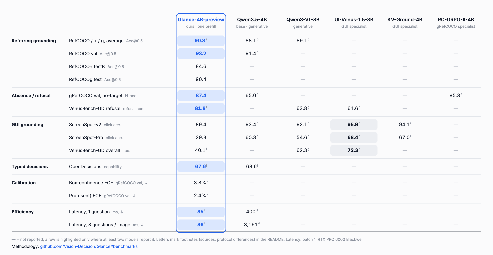

# Glance

**Calibrated typed decisions about an image or a text, in one forward pass.**

[](LICENSE)
[](https://huggingface.co/Vision-Decision/Glance-4B-preview)
[](https://huggingface.co/Vision-Decision/Glance-4B-preview)

[中文](README.zh-CN.md) · [Usage](#usage) · [Benchmarks](#benchmarks) · [Hugging Face weights](https://huggingface.co/Vision-Decision/Glance-4B-preview) · [Changelog](CHANGELOG.md)

Glance answers typed questions (find this object, pick an option, yes or no, rate on a scale) with calibrated
probabilities. It reads the image or text once and answers every question from that single prefill, without
generating tokens, and it can say "not present" with a probability attached. Eight questions about a COCO image take
**~86 ms** on an RTX PRO 6000, the same as one; the generative base model needs 3.2 s.


<sub>Glance answering 4 to 6 questions about each image or text in one forward pass (real model outputs, rendered by
[`examples/make_demo.py`](examples/make_demo.py); the raw predictions are in
[`assets/demo_predictions.json`](assets/demo_predictions.json)). Also as [MP4](assets/demo.mp4).</sub>

## Quick start

```bash
pip install "glance @ git+https://github.com/Vision-Decision/Glance"
# optional, CUDA only: fast Gated-DeltaNet kernels
pip install flash-linear-attention
```

```python
from glance import Glance

m = Glance.from_pretrained("Vision-Decision/Glance-4B-preview")   # picks cuda, then mps, then cpu
r = m.box("assets/examples/park_bench.jpg", "the clear umbrella")
print(r.present_prob, r.box, r.confidence)                 # 0.996 (189.2, 9.3, 373.6, 164.8) 0.8233
```

The first call downloads the Qwen3.5-4B base weights (~9 GB) and the Glance adapter and heads (~537 MB).

## Description

Glance is a fine-tune of [Qwen3.5-4B](https://huggingface.co/Qwen/Qwen3.5-4B) (LoRA r=64 plus small readout heads)
that turns a vision-language model into a decision function. You give it a *state* (an image, a text, or both) and a
list of typed questions; it returns a probability distribution per question:

| Primitive | You give | You get |
|---|---|---|
| `box` | a referring expression | P(present), a pixel box, P(IoU ≥ 0.5) and box confidence = P(present) · P(IoU ≥ 0.5) |
| `choice` | a question and 2–26 options | a probability per option |
| `yesno` | a yes/no question | P(yes) |
| `score` | a question and ordered levels | a probability per level and the expected level |

**Why it is different from asking a chat model**

- **It can say "not present".** The box primitive has a presence gate trained with explicit negatives (gRefCOCO
  no-target expressions and mined hard negatives). A generative grounder has to emit coordinates or a refusal string,
  and tends to draw a box anyway. On gRefCOCO no-target expressions Glance rejects 87.4% vs 65.0% for the base model.
- **Calibrated.** Probabilities come from proper-scoring-rule losses plus a per-type temperature fitted on held-out
  training-distribution data. P(present) has 2.4% ECE and box confidence 3.8% ECE on gRefCOCO val, so a threshold
  on `confidence` is a usable risk knob.
- **One pass, many questions.** The state is prefilled once. Every question is a short block that continues from
  the prefix: the Gated-DeltaNet layers start from the prefix's recurrent state, and the full-attention layers see
  the prefix plus the block (bidirectional inside the block). Blocks never see each other, so answers do not depend
  on question order, and 8 questions cost about as much as 1.
- **No parsing.** The output is a distribution over the allowed answers, never free text.

**How the box is decoded.** A soft choice over the image's visual tokens (one per 32×32 px patch) picks the patch
that holds the target; four ordinal distributions over 64 bins give the left, top, right and bottom edge offsets from
that patch; the box is their expectation. An IoU head predicts whether that box will reach IoU ≥ 0.5.

## Installation

Requires Python ≥ 3.10, PyTorch ≥ 2.4 and transformers ≥ 5.9 (for Qwen3.5).

```bash
pip install "glance @ git+https://github.com/Vision-Decision/Glance"
# or from a clone
git clone https://github.com/Vision-Decision/Glance && cd Glance && pip install -e .
```

| Device | Default precision | Notes |
|---|---|---|
| CUDA | bf16 base, fp32 LoRA under autocast (as trained) | install `flash-linear-attention` for the fast GDN kernel; without it the PyTorch reference kernel is used |
| Apple MPS | fp32 | M3 Max: ~1.4 s per image with 1 question, ~2.3 s with 8 (640 visual tokens); ~0.26 s for a short text |
| CPU | fp32 | M3 Max CPU: ~5.7 s per image with 1 question, ~8 s with 8; ~1.4 s for a short text |

The GDN layers fall back to the pure-PyTorch implementation from transformers when `fla` is not installed or the
device is not CUDA. Pass `dtype=torch.bfloat16` to `from_pretrained` to halve memory on MPS or CPU.

## Usage

All outputs below are real, from `python examples/quickstart.py` on an Apple-silicon Mac (MPS, fp32). On CUDA in
bf16 the numbers differ in the third decimal.

```python
from glance import Glance, Box, Choice, YesNo, Score

m = Glance.from_pretrained("Vision-Decision/Glance-4B-preview")
park = "assets/examples/park_bench.jpg"

m.box(park, "the clear umbrella")
# BoxResult('the clear umbrella', present_prob=0.996, box=[189, 9, 374, 165], confidence=0.823)
m.box(park, "a red bicycle")                     # not in the image
# BoxResult('a red bicycle', present_prob=0.000, box=[5, 171, 236, 363], confidence=0.000)
m.choice(park, "Where are they?", ["park", "beach", "office", "train station"])
# ChoiceResult(answer='park', probs={'park': 0.994, 'beach': 0.004, 'office': 0.001, 'train station': 0.002})
m.yesno(park, "Is it raining?")
# YesNoResult(p_yes=0.033)
m.yesno("assets/examples/editor.png", "Is a save dialog open?")
# YesNoResult(p_yes=0.992)
```

Text works the same way; pass a string as the state. Options can be a list or a `label -> description` dict.

```python
ticket = ("I was charged twice for my March invoice and the second payment is still pending. "
          "Please refund the duplicate charge before Friday.")
m.choice(ticket, "Which team should handle this ticket?",
         {"billing": "payments, invoices, refunds", "technical": "bugs, errors, outages",
          "sales": "pricing, upgrades, new plans"})
# ChoiceResult(answer='billing', probs={'billing': 0.999, 'technical': 0.000, 'sales': 0.000})
m.score(ticket, "How urgent is this ticket?", levels=["low", "medium", "high", "critical"])
# ScoreResult(answer='high', expected=1.67, probs={'low': 0.048, 'medium': 0.371, 'high': 0.446, 'critical': 0.135})
```

`ask` answers many typed questions in **one** shared-prefix pass. Plain strings are box questions.

```python
rs = m.ask("assets/examples/vegetables.jpg", [
    "the broccoli", "the tomatoes", "the carrots", "a banana", "a knife",
    YesNo("Is this food cooked?"),
    Choice("What is the main food group?", ["vegetables", "meat", "dairy", "grains"]),
    Score("How healthy is this food?", ["unhealthy", "neutral", "healthy", "very healthy"]),
])
# BoxResult('the broccoli', present_prob=0.999, box=[267, 7, 566, 247], confidence=0.821)
# BoxResult('the tomatoes', present_prob=0.999, box=[88, 201, 253, 348], confidence=0.832)
# BoxResult('the carrots', present_prob=1.000, box=[172, 223, 458, 426], confidence=0.776)
# BoxResult('a banana', present_prob=0.009, box=[208, 223, 408, 376], confidence=0.003)
# BoxResult('a knife', present_prob=0.000, box=[5, 198, 81, 357], confidence=0.000)
# YesNoResult(p_yes=0.003)
# ChoiceResult(answer='vegetables', probs={'vegetables': 0.996, 'meat': 0.003, 'dairy': 0.001, 'grains': 0.001})
# ScoreResult(answer='very healthy', expected=2.66, probs={'unhealthy': 0.006, 'neutral': 0.021, 'healthy': 0.278, 'very healthy': 0.695})
```


**Reading the results**

- `BoxResult`: `present_prob`, `box` (x1, y1, x2, y2 in pixels of the input image), `iou_prob`, `confidence`,
  `present` (`present_prob >= 0.5`). When the target is absent, `box` is still filled in but meaningless; gate on
  `present_prob` or `confidence`.
- `ChoiceResult` / `ScoreResult`: `probs` (dict in input order), `answer`; `ScoreResult.expected` is the expected
  level index (0 = lowest).
- `YesNoResult`: `p_yes`, `answer`.
- `glance.to_dict(result)` turns any result into a plain dict.

**Options**

- `max_vis_tokens` (default 640, one token per 32×32 px). 640 matches natural-image training and the reported COCO
  numbers. For dense screenshots use 2048, as in our ScreenSpot and VenusBench runs:
  `m.ask(screenshot, qs, max_vis_tokens=2048)`.
- `text=` adds text after an image in the same state: `m.ask(screenshot, qs, text="Task: export as PNG")`.
- `calibrated=False` returns untempered probabilities. The temperatures from training are in
  `glance_config.json`: presence 0.949, choice 1.046, yes/no 0.889, score 1.046 (logits are divided by T).

## Benchmarks



<sub>Also as [SVG](assets/benchmarks.svg); regenerate with `python scripts/make_benchmark_table.py`.</sub>

Glance-4B-preview leads on absence and refusal, calibration and latency, and it is ahead of the generative base on
referring grounding. It trails the GUI specialists clearly on ScreenSpot-Pro and VenusBench-GD grounding (and
the base model on ScreenSpot-v2): the preview saw relatively little high-resolution GUI data, and it reads a
screenshot in a single pass at ≤2,048 visual tokens without zoom.

### Full results for Glance-4B-preview

| Benchmark | Metric | Glance-4B-preview |
|---|---|---|
| RefCOCO val / testA / testB | Acc@0.5 | 93.2 / 94.5 / 90.7 |
| RefCOCO+ val / testA / testB | Acc@0.5 | 89.7 / 93.3 / 84.6 |
| RefCOCOg val / test | Acc@0.5 | 90.0 / 90.4 |
| RefCOCO family, 8-split mean | Acc@0.5 | 90.8 |
| gRefCOCO val (no-target) | N-acc | 87.4 |
| gRefCOCO val + RefCOCO val | AUROC of P(present) | 97.9 |
| gRefCOCO val + RefCOCO val | ECE of P(present) / of box confidence | 2.4% / 3.8% |
| VenusBench-GD (official evaluator) | refusal / overall | 81.8 / 40.1 |
| ScreenSpot-v2 | click accuracy | 89.4 |
| ScreenSpot-Pro | click accuracy | 29.3 |
| OpenDecisions (2,352 items) | capability / calibration | 67.6 / 80.4 |
| Latency, RTX PRO 6000, batch 1 | 1 / 8 box questions per image; 1 text question | 85.5 / 85.6 / 67.3 ms |

### Comparison (same as the image)

| Category | Benchmark (metric) | **Glance-4B-preview** | Qwen3.5-4B | Qwen3-VL-8B | UI-Venus-1.5-8B | KV-Ground-4B | RC-GRPO-II-4B |
|---|---|---|---|---|---|---|---|
| Referring grounding | RefCOCO / + / g, average (Acc@0.5) | **90.8**ᵃ | 88.1ᵇ | 89.1ᶜ | — | — | — |
| | RefCOCO val (Acc@0.5) | **93.2** | 91.4ᵈ | — | — | — | — |
| | RefCOCO+ testB (Acc@0.5) | 84.6 | — | — | — | — | — |
| | RefCOCOg test (Acc@0.5) | 90.4 | — | — | — | — | — |
| Absence / refusal | gRefCOCO val, no-target (N-acc) | **87.4** | 65.0ᵈ | — | — | — | 85.3ᵉ |
| | VenusBench-GD refusal (acc.) | **81.8**ᶠ | — | 63.8ᵍ | 61.6ʰ | — | — |
| GUI grounding | ScreenSpot-v2 (click acc.) | 89.4 | 93.4ᵈ | 92.1ʰ | **95.9**ʰ | 94.1ⁱ | — |
| | ScreenSpot-Pro (click acc.) | 29.3 | 60.3ᵇ | 54.6ᶜ | **68.4**ʰ | 67.0ⁱ | — |
| | VenusBench-GD overall (acc.) | 40.1ᶠ | — | 62.3ᵍ | **72.3**ʰ | — | — |
| Typed decisions | OpenDecisions (capability) | **67.6**ʲ | 63.6ʲ | — | — | — | — |
| Calibration | Box-confidence ECE, gRefCOCO val (↓) | 3.8%ᵏ | — | — | — | — | — |
| | P(present) ECE, gRefCOCO val (↓) | 2.4%ᵏ | — | — | — | — | — |
| Efficiency | Latency, 1 question (ms, ↓) | **85**ˡ | 400ᵈ | — | — | — | — |
| | Latency, 8 questions per image (ms, ↓) | **86**ˡ | 3,161ᵈ | — | — | — | — |

"—" means not reported in a primary source we could verify. Bold marks the best value in a row where at least two
models report one.

### Protocol

- **Glance numbers** come from one evaluation run of the released checkpoint (step 3,844) on an RTX PRO 6000
  Blackwell in bf16 with the `fla` kernels. Every number is single-pass: no zoom, no test-time augmentation, no
  second look. Natural images are resized to ≤640 visual tokens (COCO 640×480 → 29×22 patches); GUI screenshots to
  ≤2,048 visual tokens (upscaling up to 2× allowed).
- **REC metric.** Acc@0.5 is the fraction of expressions whose decoded box reaches IoU ≥ 0.5 with the ground truth,
  ignoring the presence gate (standard REC). With the gate required (P(present) ≥ 0.5), RefCOCO val drops from 93.2
  to 92.0.
- **GUI metric.** Click accuracy: the center of the predicted box lies inside the ground-truth box.
- **Calibration.** 15 equal-width bins. Temperatures were fitted on held-out splits of the training distribution,
  never on an evaluation set.
- **Decontamination.** Every image that appears in any RefCOCO/+/g or gRefCOCO evaluation split was removed from
  training (RefCOCOg-umd train overlaps RefCOCO-unc val/test images), and evaluation images of the other benchmarks
  were removed by perceptual hash.
- **External numbers** are copied from the cited primary sources. Their prompts, resolutions and modes differ from
  ours (some report thinking mode, some use their own reproductions), so treat cross-column comparisons as
  indicative.

### Footnotes

- ᵃ Mean of the 8 splits listed under *Full results*.
- ᵇ Qwen3.5-4B official model card, <https://huggingface.co/Qwen/Qwen3.5-4B>, rows "RefCOCO(avg)" and
  "ScreenSpot Pro". The card does not say which RefCOCO splits are averaged or whether thinking mode was used
  (thinking is the model's default).
- ᶜ Qwen3-VL technical report, [arXiv:2511.21631](https://arxiv.org/abs/2511.21631), Table 4, Qwen3-VL-8B-Instruct
  ("RefCOCO-avg", splits not stated; ScreenSpot Pro).
- ᵈ Our measurement of the generative Qwen3.5-4B (bf16, greedy, thinking off, HF `generate`) on the same GPU and image
  resolution as Glance. RefCOCO val and gRefCOCO no-target: random 500-expression subsets (seed 0) with the prompt
  "Locate the object described as … Output its bounding box as [x1, y1, x2, y2] … If no such object is in the image,
  answer exactly "none"". ScreenSpot-v2: all 1,272 items with the official ScreenSpot-Pro Qwen3.5 prompt at ≤4,000
  visual tokens. Latency: median per image for 1 question, and for 8 questions about the same image answered by 8
  sequential `generate` calls; unlike Glance's timing it includes the processor call (≈ a few ms) and it uses
  unoptimised HF generation, so a serving engine would be faster.
- ᵉ RC-GRPO, [arXiv:2608.04698](https://arxiv.org/abs/2608.04698), Table 1: RC-GRPO-II on Qwen3-VL-4B, gRefCOCO val
  N-acc. The same table gives 77.2 for Qwen3-VL-4B-Instruct.
- ᶠ Official UI-Venus evaluation code. Glance refuses when P(present) < 0.5, and a refused item gets no click, so a
  refusal on a positive item counts as wrong. Overall is the micro-average over all 6,165 items in our copy (899
  refusal); the paper lists 6,166 items (900 refusal). An earlier version of this table showed 81.5 / 52.3 from our
  own script, which still scored the click on positive items the model had refused; that overall is withdrawn.
- ᵍ VenusBench-GD paper, [arXiv:2512.16501](https://arxiv.org/abs/2512.16501), Table 5 (Qwen3-VL-8B: overall 62.34,
  refusal 63.78). The UI-Venus-1.5 report reproduces Qwen3-VL-8B much lower (overall 55.1, refusal 6.8), so refusal
  scores of generative models depend strongly on prompt and refusal format.
- ʰ UI-Venus-1.5 technical report, [arXiv:2602.09082](https://arxiv.org/abs/2602.09082), Table 1 (ScreenSpot-Pro,
  ScreenSpot-v2, VenusBench-GD overall) and Table 9 (refusal). The Qwen3-VL-8B ScreenSpot-v2 value is that report's
  reproduction. The KV-Ground card lists UI-Venus-1.5-8B at 93.2 on ScreenSpot-v2.
- ⁱ KV-Ground-4B-BaseGuiOwl1.5-0228 model card, <https://huggingface.co/vocaela/KV-Ground-4B-BaseGuiOwl1.5-0228>
  (GUI-Owl-1.5-4B base, no zoom).
- ʲ OpenDecisions' own `score.py` on all 2,352 items. Both models answer in one pass by reading the probabilities of the
  answer-label tokens (the base model through its LM head) with temperatures fitted on held-out training-distribution
  data. Without temperatures: Glance 67.1, base 51.9.
- ᵏ gRefCOCO val (8,905 no-target expressions) merged with RefCOCO val (the same 1,500 images; this gRefCOCO release
  has no single-target val expressions), 25,063 expressions. Box confidence is scored against the event
  "present and IoU ≥ 0.5".
- ˡ Median over 100 RefCOCO val images, batch 1, bf16 + `fla`, RTX PRO 6000 Blackwell Server Edition; includes the
  vision encoder and all heads, excludes JPEG decoding and resizing.

## Limitations

- **Preview.** One epoch on ~212k states / 520k questions. Expect rough edges outside the training mix.
- **GUI grounding is not competitive yet**, especially on high-resolution professional software (ScreenSpot-Pro
  29.3). Use a GUI specialist if you need click accuracy; Glance's GUI strength today is state checks and refusal.
- **One box per expression.** The box head returns one box; for multi-target expressions it reports presence and the
  most likely instance.
- **Calibration is measured in distribution.** Temperatures were fitted on held-out training-distribution data. On
  shifted data (e.g. VenusBench-GD, AUROC of P(present) 0.74) probabilities are less reliable; recalibrate on your data
  if you depend on thresholds.
- **Score questions** are the weakest typed primitive (OpenDecisions score competence 42.6). Distributions over
  ambiguous rubrics are often flat, which is honest but less useful.
- **English only** was trained and evaluated.
- **The box for an absent target is meaningless.** Always gate on `present_prob` or `confidence`.
- **Off CUDA it is not fast.** Without `flash-linear-attention` the GDN layers use the PyTorch reference kernel; a
  Mac takes ~1.4 s (MPS) to ~6 s (CPU) per image.

## Roadmap

- **v1.1**: more and harder GUI data (desktop and high-resolution screenshots), label smoothing for choice, scoring
  with the official VenusBench-GD code.
- **27B**: the same recipe on a 27B Qwen3.5 base.
- **Video tool**: a yes/no scan over short clips (P(t) curves for find / count / verify) for agent planners.
- **Data release**: the training mixture and preparation scripts, once licenses are cleared.
- Multi-box output (one sigmoid per patch) for multi-target expressions and counting.

## License

- **Code** in this repository: [Apache-2.0](LICENSE).
- **Weights** (`Vision-Decision/Glance-4B-preview`, the LoRA adapter and heads): **CC BY-NC 4.0**, non-commercial. The
  training data includes gRefCOCO (non-commercial) and some text sources whose licenses we could not confirm.
- **Base model** [Qwen/Qwen3.5-4B](https://huggingface.co/Qwen/Qwen3.5-4B): Apache-2.0, downloaded from its own
  repository.
- **Example images**: `assets/examples/park_bench.jpg` and `vegetables.jpg` are COCO test2017 images 448261 and
  388694, licensed [CC BY 2.0](https://creativecommons.org/licenses/by/2.0/) by their Flickr authors (see the
  [COCO](https://cocodataset.org) image info). `editor.png` is a made-up UI rendered from
  [`examples/gui_mock.html`](examples/gui_mock.html).

## Citation

A paper is in preparation. Until then:

```bibtex
@misc{glance2026,
  title  = {Glance: Calibrated Typed Decisions in One Forward Pass},
  author = {Vision-Decision},
  year   = {2026},
  url    = {https://github.com/Vision-Decision/Glance},
  note   = {Glance-4B-preview, https://huggingface.co/Vision-Decision/Glance-4B-preview}
}
```

## Acknowledgements

- The [Qwen](https://huggingface.co/Qwen) team for Qwen3.5-4B, and the Hugging Face `transformers` and `peft` libraries.
- [flash-linear-attention](https://github.com/fla-org/flash-linear-attention) for the Gated-DeltaNet kernels.
- The authors of RefCOCO/+/g, gRefCOCO, COCO, PixMo, OS-Atlas, AGUVIS, and the text decision datasets used in training.
- The ScreenSpot-v2, ScreenSpot-Pro, VenusBench-GD and OpenDecisions benchmark authors.
- Ideas we build on: GUI-Actor (patch selection for grounding), Generalized Focal Loss (edge distributions) and SAM 3's
  presence token.
