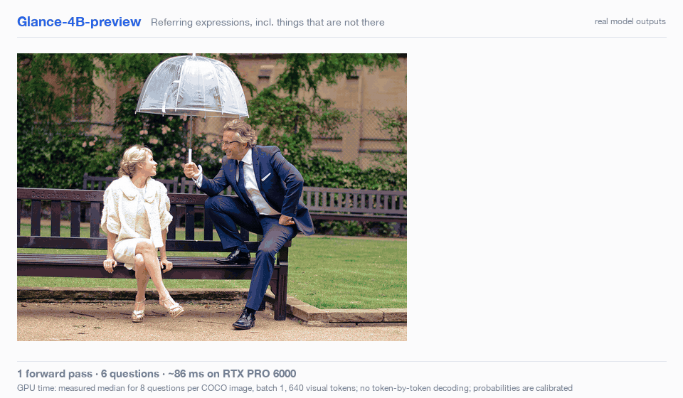
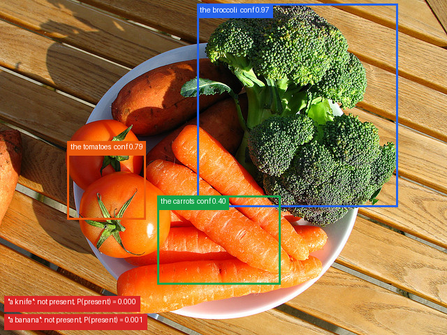
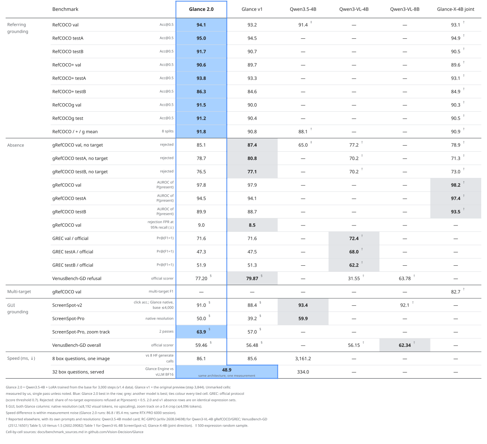

# Glance

**Calibrated typed decisions about an image or a text, in one forward pass.**

[](LICENSE)
[](https://huggingface.co/Vision-Decision/Glance-4B-preview)
[](https://huggingface.co/Vision-Decision/Glance-4B-preview)

[中文](README.zh-CN.md) · [Usage](#usage) · [Benchmarks](#benchmarks) · [Versions](#versions) · [Hugging Face weights](https://huggingface.co/Vision-Decision/Glance-4B-preview) · [Changelog](CHANGELOG.md)

Glance answers typed questions (find this object, pick an option, yes or no, rate on a scale) with calibrated
probabilities. It reads the image or text once and answers every question from that single prefill, without
generating tokens, and it can say "not present" with a probability attached. Eight questions about a COCO image take
**~86 ms** on an RTX PRO 6000, the same as one; the generative base model needs 3.2 s.



<sub>Glance answering 4 to 6 questions about each image or text in one forward pass (real model outputs, rendered by
[`examples/make_demo.py`](examples/make_demo.py); the raw predictions are in
[`assets/demo_predictions.json`](assets/demo_predictions.json)). Also as [MP4](assets/demo.mp4).</sub>

## Quick start

```bash
pip install "glance @ git+https://github.com/Vision-Decision/Glance"
# optional, CUDA only: fast Gated-DeltaNet kernels
pip install flash-linear-attention
```

```python
from glance import Glance

m = Glance.from_pretrained("Vision-Decision/Glance-4B-preview")   # picks cuda, then mps, then cpu
r = m.box("assets/examples/park_bench.jpg", "the clear umbrella")
print(r.present_prob, r.box, r.confidence)                 # 0.995 (191, 5, 372, 166) 0.915
```

The first call downloads the Qwen3.5-4B base weights (~9 GB) and the Glance adapter and heads (~537 MB).

## Description

Glance is a fine-tune of [Qwen3.5-4B](https://huggingface.co/Qwen/Qwen3.5-4B) (LoRA r=64 plus small readout heads)
that turns a vision-language model into a decision function. You give it a *state* (an image, a text, or both) and a
list of typed questions; it returns a probability distribution per question:

| Primitive | You give | You get |
|---|---|---|
| `box` | a referring expression | P(present), a pixel box, P(IoU ≥ 0.5) and box confidence = P(present) · P(IoU ≥ 0.5) |
| `choice` | a question and 2–26 options | a probability per option |
| `yesno` | a yes/no question | P(yes) |
| `score` | a question and ordered levels | a probability per level and the expected level |

**Why it is different from asking a chat model**

- **It can say "not present".** The box primitive has a presence gate trained with explicit negatives (gRefCOCO
  no-target expressions and mined hard negatives). A generative grounder has to emit coordinates or a refusal string,
  and tends to draw a box anyway. On gRefCOCO no-target expressions Glance 2.0 rejects 85.1% vs 65.0% for the base model.
- **Calibrated.** Probabilities come from proper-scoring-rule losses plus a per-type temperature fitted on held-out
  training-distribution data. P(present) has 3.0% ECE and box confidence 5.1% ECE on gRefCOCO val (v1: 2.4% / 3.8%), so a threshold
  on `confidence` is a usable risk knob.
- **One pass, many questions.** The state is prefilled once. Every question is a short block that continues from
  the prefix: the Gated-DeltaNet layers start from the prefix's recurrent state, and the full-attention layers see
  the prefix plus the block (bidirectional inside the block). Blocks never see each other, so answers do not depend
  on question order, and 8 questions cost about as much as 1.
- **No parsing.** The output is a distribution over the allowed answers, never free text.

**How the box is decoded.** A soft choice over the image's visual tokens (one per 32×32 px patch) picks the patch
that holds the target; four ordinal distributions over 64 bins give the left, top, right and bottom edge offsets from
that patch; the box is their expectation. An IoU head predicts whether that box will reach IoU ≥ 0.5.

## Installation

Requires Python ≥ 3.10, PyTorch ≥ 2.4 and transformers ≥ 5.9 (for Qwen3.5).

```bash
pip install "glance @ git+https://github.com/Vision-Decision/Glance"
# or from a clone
git clone https://github.com/Vision-Decision/Glance && cd Glance && pip install -e .
```

| Device | Default precision | Notes |
|---|---|---|
| CUDA | bf16 base, fp32 LoRA under autocast (as trained) | install `flash-linear-attention` for the fast GDN kernel; without it the PyTorch reference kernel is used |
| Apple MPS | fp32 | M3 Max: ~1.4 s per image with 1 question, ~2.3 s with 8 (640 visual tokens); ~0.26 s for a short text |
| CPU | fp32 | M3 Max CPU: ~5.7 s per image with 1 question, ~8 s with 8; ~1.4 s for a short text |

The GDN layers fall back to the pure-PyTorch implementation from transformers when `fla` is not installed or the
device is not CUDA. Pass `dtype=torch.bfloat16` to `from_pretrained` to halve memory on MPS or CPU.

## Usage

All outputs below are real, from `python examples/quickstart.py` with Glance 2.0 on CUDA (RTX PRO 6000, bf16). On MPS
or CPU in fp32 the numbers differ in the third decimal.

```python
from glance import Glance, Box, Choice, YesNo, Score

m = Glance.from_pretrained("Vision-Decision/Glance-4B-preview")
park = "assets/examples/park_bench.jpg"

m.box(park, "the clear umbrella")
# BoxResult('the clear umbrella', present_prob=0.995, box=[191, 5, 372, 166], confidence=0.915)
m.box(park, "a red bicycle")                     # not in the image
# BoxResult('a red bicycle', present_prob=0.000, box=[465, 213, 583, 265], confidence=0.000)
m.choice(park, "Where are they?", ["park", "beach", "office", "train station"])
# ChoiceResult(answer='park', probs={'park': 0.989, 'beach': 0.005, 'office': 0.003, 'train station': 0.003})
m.yesno(park, "Is it raining?")
# YesNoResult(p_yes=0.136)
m.yesno("assets/examples/editor.png", "Is a save dialog open?")
# YesNoResult(p_yes=0.998)
```

Text works the same way; pass a string as the state. Options can be a list or a `label -> description` dict.

```python
ticket = ("I was charged twice for my March invoice and the second payment is still pending. "
          "Please refund the duplicate charge before Friday.")
m.choice(ticket, "Which team should handle this ticket?",
         {"billing": "payments, invoices, refunds", "technical": "bugs, errors, outages",
          "sales": "pricing, upgrades, new plans"})
# ChoiceResult(answer='billing', probs={'billing': 0.987, 'technical': 0.008, 'sales': 0.005})
m.score(ticket, "How urgent is this ticket?", levels=["low", "medium", "high", "critical"])
# ScoreResult(answer='high', expected=1.62, probs={'low': 0.045, 'medium': 0.373, 'high': 0.502, 'critical': 0.080})
```

`ask` answers many typed questions in **one** shared-prefix pass. Plain strings are box questions.

```python
rs = m.ask("assets/examples/vegetables.jpg", [
    "the broccoli", "the tomatoes", "the carrots", "a banana", "a knife",
    YesNo("Is this food cooked?"),
    Choice("What is the main food group?", ["vegetables", "meat", "dairy", "grains"]),
    Score("How healthy is this food?", ["unhealthy", "neutral", "healthy", "very healthy"]),
])
# BoxResult('the broccoli', present_prob=0.997, box=[282, 6, 570, 296], confidence=0.969)
# BoxResult('the tomatoes', present_prob=0.998, box=[97, 202, 208, 315], confidence=0.785)
# BoxResult('the carrots', present_prob=0.998, box=[226, 280, 402, 408], confidence=0.404)
# BoxResult('a banana', present_prob=0.001, box=[156, 89, 287, 174], confidence=0.001)
# BoxResult('a knife', present_prob=0.000, box=[205, 148, 343, 259], confidence=0.000)
# YesNoResult(p_yes=0.062)
# ChoiceResult(answer='vegetables', probs={'vegetables': 0.985, 'meat': 0.006, 'dairy': 0.004, 'grains': 0.004})
# ScoreResult(answer='very healthy', expected=2.71, probs={'unhealthy': 0.005, 'neutral': 0.013, 'healthy': 0.250, 'very healthy': 0.732})
```



**Reading the results**

- `BoxResult`: `present_prob`, `box` (x1, y1, x2, y2 in pixels of the input image), `iou_prob`, `confidence`,
  `present` (`present_prob >= 0.5`). When the target is absent, `box` is still filled in but meaningless; gate on
  `present_prob` or `confidence`.
- `ChoiceResult` / `ScoreResult`: `probs` (dict in input order), `answer`; `ScoreResult.expected` is the expected
  level index (0 = lowest).
- `YesNoResult`: `p_yes`, `answer`.
- `glance.to_dict(result)` turns any result into a plain dict.

**Options**

- `max_vis_tokens` (default 640, one token per 32×32 px). 640 matches natural-image training and the reported COCO
  numbers. For dense screenshots use 2048, as in our ScreenSpot and VenusBench runs:
  `m.ask(screenshot, qs, max_vis_tokens=2048)`.
- `text=` adds text after an image in the same state: `m.ask(screenshot, qs, text="Task: export as PNG")`.
- `calibrated=False` returns untempered probabilities. The temperatures from training are in
  `glance_config.json`: presence 1.005, choice 0.903, yes/no 0.935, score 0.870 for Glance 2.0 (logits are divided by T).

## Benchmarks

<picture>
  <source media="(prefers-color-scheme: dark)" srcset="assets/benchmark-table-dark.svg">
  
</picture>

<sub>Also as PNG ([light](assets/benchmark-table-light.png), [dark](assets/benchmark-table-dark.png)); regenerate with
`python scripts/bench_table.py scripts/benchmark_table.json assets/benchmark-table`. Every cell's source:
[docs/benchmark_sources.md](docs/benchmark_sources.md).</sub>

Glance 2.0 is ahead of v1 on every RefCOCO split (8-split mean 91.8 vs 90.8). On rejecting absent objects it ranks absent below
present as well as v1 does: the rejection FPR at 95% recall is 9.0 vs 8.5 (difference +0.49, 95% CI [−0.15, +1.25],
paired bootstrap over expressions), AUROC is within 0.1 on val and higher on testA/testB, and the official GREC score
is equal on val. At the fixed 0.5 cut-off it refuses somewhat less often (85.1% vs 87.4% of gRefCOCO val no-target
expressions); if you rely on rejection, set the threshold on `present_prob` for your own recall target. On GUI grounding, with both checkpoints read at native resolution, 2.0 reaches 91.0 on ScreenSpot-v2 (v1 88.4), 50.0 on ScreenSpot-Pro (v1 39.2; zoom track 63.9 vs 57.0) and 59.5 on VenusBench-GD overall (v1 56.5). Against other
models, Glance-X-4B leads on presence AUROC, Qwen3-VL-4B on the official GREC metric, and the generative base and
Qwen3-VL on ScreenSpot.

### Full results: Glance 2.0 and v1

Both columns are scored with the same code on the same expression sets (absence rows: identical expressions, matched one to one).

| Benchmark | Metric | Glance v1 | **Glance 2.0** |
|---|---|---|---|
| RefCOCO val / testA / testB | Acc@0.5 (standard) | 93.2 / 94.5 / 90.7 | 94.1 / 95.0 / 91.7 |
| RefCOCO+ val / testA / testB | Acc@0.5 (standard) | 89.7 / 93.3 / 84.6 | 90.6 / 93.8 / 86.3 |
| RefCOCOg val / test | Acc@0.5 (standard) | 90.0 / 90.4 | 91.5 / 91.2 |
| RefCOCO family, 8-split mean | Acc@0.5 (standard) | 90.8 | 91.8 |
| GREC val / testA / testB | official Pr@(F1=1), score threshold 0.7 | 71.6 / 47.5 / 51.3 | 71.6 / 47.3 / 51.9 |
| gRefCOCO val, no target | rejection FPR at 95% recall (↓) | 8.5 | 9.0 |
| gRefCOCO val / testA / testB, no target | rejected at P(present) < 0.5 | 87.4 / 80.8 / 77.1 | 85.1 / 78.7 / 76.5 |
| gRefCOCO val / testA / testB | AUROC of P(present) | 97.9 / 94.1 / 88.7 | 97.8 / 94.5 / 89.9 |
| ScreenSpot-v2 | click accuracy ² | 88.4 | 91.0 |
| ScreenSpot-Pro | click accuracy, native resolution ² | 39.2 | 50.0 |
| ScreenSpot-Pro | click accuracy, zoom track (2 passes) ² | 57.0 | 63.9 |
| VenusBench-GD | overall / refusal (official evaluator) ² | 56.48 / 79.87 | 59.46 / 77.20 |

² Both columns: native resolution, ≤8,192 visual tokens, no upscaling; zoom track on a 0.4 crop (≤4,096 tokens).

With the presence gate required (P(present) ≥ 0.5), RefCOCO val is 92.0 for v1 and 93.1 for 2.0, and the 8-split mean is 90.8 for 2.0.

### Comparison (same as the image)

| Category | Benchmark (metric) | **Glance 2.0** | Glance v1 | Qwen3.5-4B | Qwen3-VL-4B | Qwen3-VL-8B | Glance-X-4B joint |
|---|---|---|---|---|---|---|---|
| Referring grounding | RefCOCO val (Acc@0.5) | **94.1** | 93.2 | 91.4‡ | — | — | 93.1† |
|  | RefCOCO testA (Acc@0.5) | **95.0** | 94.5 | — | — | — | 94.9† |
|  | RefCOCO testB (Acc@0.5) | **91.7** | 90.7 | — | — | — | 90.5† |
|  | RefCOCO+ val (Acc@0.5) | **90.6** | 89.7 | — | — | — | 89.6† |
|  | RefCOCO+ testA (Acc@0.5) | **93.8** | 93.3 | — | — | — | 93.1† |
|  | RefCOCO+ testB (Acc@0.5) | **86.3** | 84.6 | — | — | — | 84.9† |
|  | RefCOCOg val (Acc@0.5) | **91.5** | 90.0 | — | — | — | 90.3† |
|  | RefCOCOg test (Acc@0.5) | **91.2** | 90.4 | — | — | — | 90.5† |
|  | RefCOCO / + / g mean (8 splits) | **91.8** | 90.8 | 88.1† | — | — | 90.9† |
| Absence | gRefCOCO val, no target (rejected) | 85.1 | **87.4** | 65.0‡ | 77.2† | — | 78.9† |
|  | gRefCOCO testA, no target (rejected) | 78.7 | **80.8** | — | 70.2† | — | 71.3† |
|  | gRefCOCO testB, no target (rejected) | 76.5 | **77.1** | — | 70.2† | — | 73.0† |
|  | gRefCOCO val (AUROC of P(present)) | 97.8 | 97.9 | — | — | — | **98.2†** |
|  | gRefCOCO testA (AUROC of P(present)) | 94.5 | 94.1 | — | — | — | **97.4†** |
|  | gRefCOCO testB (AUROC of P(present)) | 89.9 | 88.7 | — | — | — | **93.5†** |
|  | gRefCOCO val (rejection FPR at 95% recall (↓)) | 9.0 | **8.5** | — | — | — | — |
|  | GREC val / official (Pr@(F1=1)) | 71.6 | 71.6 | — | **72.4†** | — | — |
|  | GREC testA / official (Pr@(F1=1)) | 47.3 | 47.5 | — | **68.0†** | — | — |
|  | GREC testB / official (Pr@(F1=1)) | 51.9 | 51.3 | — | **62.2†** | — | — |
|  | VenusBench-GD refusal (official scorer) | 77.20§ | **79.87§** | — | 31.55† | 63.78† | — |
| Multi-target | gRefCOCO val (multi-target F1) | — | — | — | — | — | 82.7† |
| GUI grounding | ScreenSpot-v2 (click acc.; Glance native, base ≤4,000) | 91.0§ | 88.4§ | **93.4** | — | 92.1† | — |
|  | ScreenSpot-Pro (native resolution) | 50.0§ | 39.2§ | **59.9** | — | — | — |
|  | ScreenSpot-Pro, zoom track (2 passes) | **63.9§** | 57.0§ | — | — | — | — |
|  | VenusBench-GD overall (official scorer) | 59.46§ | 56.48§ | — | 56.15† | **62.34†** | — |
| Speed (ms, ↓) | 8 box questions, one image (vs 8 HF generate calls) | 86.1 | **85.6** | 3,161.2 | — | — | — |
|  | 32 box questions, served (Glance Engine vs vLLM BF16) | 48.9 (both, same architecture) | ← shared | 334.0 | — | — | — |

"—" means not measured or not reported. Bold marks the best value in a row where at least two models report one;
ties at the shown precision are all bold. Unmarked values are our measurements; † reported elsewhere (see
*Sources*); ‡ random 500-expression sample; § GUI resolution of the Glance columns, see *Protocol*. Glance 2.0 has
no multi-box heads; a speed cell shared by both Glance columns is one measurement (same architecture and size).

### Protocol

- **Glance 2.0 numbers** come from one evaluation run of the released checkpoint (step 3,000) on an A100 80GB in bf16
  with the `fla` kernels: natural images at ≤640 visual tokens, GUI screenshots at native resolution (≤8,192 visual
  tokens, no upscaling), ScreenSpot-Pro zoom track on a 0.4 crop (≤4,096 tokens). Single pass unless noted.
- **Glance v1 numbers** come from one evaluation run of the v1 checkpoint (step 3,844) on an RTX PRO 6000
  Blackwell in bf16 with the `fla` kernels. Every number is single-pass: no zoom, no test-time augmentation, no
  second look. Natural images are resized to ≤640 visual tokens (COCO 640×480 → 29×22 patches); GUI screenshots to
  ≤2,048 visual tokens (upscaling up to 2× allowed). In the comparison, ScreenSpot-Pro is read at native resolution
  (median 4,080 visual tokens, no upscaling) to match our base-model run: 39.3, against 29.3 at ≤2,048 tokens. The
  zoom-track row adds a second pass on a 0.25 crop.
- **REC metric.** Acc@0.5 is the fraction of expressions whose decoded box reaches IoU ≥ 0.5 with the ground truth,
  ignoring the presence gate (standard REC). With the gate required (P(present) ≥ 0.5), RefCOCO val drops from 93.2
  to 92.0.
- **GREC metric.** Port of the official gRefCOCO evaluator: the predicted box is kept when its score P(present) ≥ 0.7,
  a prediction matches at GIoU ≥ 0.5, and an expression counts when F1 = 1 (a no-target expression counts when nothing
  is kept). Each split is the gRefCOCO split joined with the RefCOCO-unc expressions of the same images (val 25,063 /
  testA 19,200 / testB 16,063 expressions), the same for both Glance columns.
- **Rejection FPR at 95% recall.** On gRefCOCO val (8,905 no-target expressions): the P(present) threshold is set so
  that 95% of present targets are accepted, and the FPR is the share of no-target expressions accepted at that
  threshold. It does not depend on the 0.5 cut-off, so it compares how well two models rank absent below present.
- **GUI metric.** Click accuracy: the center of the predicted box lies inside the ground-truth box.
- **Calibration.** 15 equal-width bins. Temperatures were fitted on held-out splits of the training distribution,
  never on an evaluation set.
- **Decontamination** (both checkpoints). Every image that appears in any RefCOCO/+/g or gRefCOCO evaluation split
  was removed from training (RefCOCOg-umd train overlaps RefCOCO-unc val/test images), and evaluation images of the
  other benchmarks were removed by perceptual hash. For 2.0 the excluded list also covers COCO val2017 and our probe
  images, and the final training file was checked against the evaluation splits: zero overlapping images (74,932 COCO images in 443,460 training records against 6,549 images of the 12 evaluation splits).
- **External numbers** are copied from the cited primary sources. Their prompts, resolutions and modes differ from
  ours (some report thinking mode, some use their own reproductions), so treat cross-column comparisons as
  indicative.

### Sources

Cell by cell: [benchmark_sources.md](docs/benchmark_sources.md).

- Qwen3.5-4B model card, <https://huggingface.co/Qwen/Qwen3.5-4B>, "RefCOCO(avg)" (splits not stated).
- RC-GRPO, [arXiv:2608.04698](https://arxiv.org/abs/2608.04698), Table 1: Qwen3-VL-4B-Instruct on gRefCOCO (GREC
  Pr@(F1=1) and N-acc, official protocol).
- VenusBench-GD, [arXiv:2512.16501](https://arxiv.org/abs/2512.16501), Table 5: Qwen3-VL-4B and -8B overall and
  refusal. The UI-Venus-1.5 report reproduces Qwen3-VL-8B much lower (overall 55.1, refusal 6.8), so refusal scores of
  generative models depend strongly on prompt and refusal format.
- UI-Venus-1.5, [arXiv:2602.09082](https://arxiv.org/abs/2602.09082), Table 1: Qwen3-VL-8B on ScreenSpot-v2 (that
  report's reproduction).
- Glance-X-4B: [Glanece-Training docs/RESULTS.md](https://github.com/Vision-Decision/Glanece-Training/blob/main/docs/RESULTS.md),
  joint direction (K=8, step 6,100).
- Our base-model runs: generative Qwen3.5-4B, bf16, greedy, thinking off, HF `generate`, same GPU. RefCOCO val and
  gRefCOCO no-target on random 500-expression subsets; ScreenSpot-v2 on all 1,272 items at ≤4,000 visual tokens;
  ScreenSpot-Pro on all 1,581 items at native resolution; latency: 8 questions about one image as 8 sequential
  `generate` calls.
- Served latency: Glance Engine against vLLM 0.34.0 serving Qwen3.5-4B in BF16, 32 box questions about one image,
  warm median on one RTX PRO 6000
  ([CEILING.md](https://github.com/Vision-Decision/glance-engine/blob/release/outputs/engine_opt/CEILING.md)).
- Official UI-Venus evaluation code for VenusBench-GD: Glance refuses when P(present) < 0.5, and a refused positive
  item counts as wrong. Our copy has 6,165 items (899 refusal); the paper lists 6,166 (900).

## Versions

Every checkpoint loads with `Glance.from_pretrained(repo)`. Glance 2.0 is the main branch of
`Vision-Decision/Glance-4B-preview`; the original v1 stays in the same repository under the tag `v1`
(`Glance.from_pretrained("Vision-Decision/Glance-4B-preview", revision="v1")`). The other versions are separate repositories. Each card
lists what changed, the full results against that version's pre-registered bars, and its known regressions.

| Version | Weights | Built from | Summary | Use it for |
|---|---|---|---|---|
| **2.0** | [Glance-4B-preview](https://huggingface.co/Vision-Decision/Glance-4B-preview) (main) | Qwen3.5-4B | Glance 2.0: trained from the base for 3,000 steps on the v1.4 mixture; RefCOCO 8-split 91.8, RefCOCO+ testB 86.3; rejection at 95% recall level with v1 | **default** |
| v1 | [Glance-4B-preview](https://huggingface.co/Vision-Decision/Glance-4B-preview) at `revision="v1"` | Qwen3.5-4B | first public release (step 3,844); the v1 column above | the reference preview |
| v1.1 | [Glance-4B-v1.1](https://huggingface.co/Vision-Decision/Glance-4B-v1.1) | Qwen3.5-4B | v1 recipe plus high-resolution GUI data; RefCOCO 8-split 92.8, but many false "not present" on function, generic and relational wording | reproducing v1.1 |
| v1.2 | [Glance-4B-v1.2](https://huggingface.co/Vision-Decision/Glance-4B-v1.2) | v1.1 | fixes the description-shift failures (false "not present" 37–51% → 1–4%); RefCOCO 8-split drops to 91.4 | reproducing v1.2 |
| v1.2b | [Glance-4B-v1.2b](https://huggingface.co/Vision-Decision/Glance-4B-v1.2b) | v1.2 | adds multi-box heads (gRefCOCO multi-target set F1 79.7) | reproducing v1.2b |
| v1.3 | [Glance-4B-v1.3](https://huggingface.co/Vision-Decision/Glance-4B-v1.3) | v1.2 | re-balanced mix: RefCOCO 8-split back to 92.7, description-shift gains kept; Chinese no-target N-acc falls 82.3 → 65.6 | **single-box use** |
| v1.3b | [Glance-4B-v1.3b](https://huggingface.co/Vision-Decision/Glance-4B-v1.3b) | v1.3 | v1.3 plus multi-box heads: multi-target set F1 82.7; RefCOCO 8-split 0.72 below v1.3 | **multi-target use** |

Multi-box models answer `Boxes` questions with every instance an expression covers:

```python
m = Glance.from_pretrained("Vision-Decision/Glance-4B-v1.3b")
m.boxes("park_bench.jpg", "the people on the bench")   # BoxesResult(..., boxes=[[...], [...]])
```

### Quick bench across versions

[`examples/quick_bench.py`](examples/quick_bench.py) runs in a few minutes on one GPU on small fixed subsets of
public benchmarks (item ids in [`examples/quick_bench_items.json`](examples/quick_bench_items.json), seed 0):

```bash
pip install pandas
python examples/quick_bench.py --model Vision-Decision/Glance-4B-v1.3
```

| Version | RefCOCO val Acc@0.5 (200) | gRefCOCO no-target N-acc (200) | gRefCOCO multi-target set F1 (100) | ScreenSpot-v2 click (100) | Latency, 1 / 8 questions (ms) |
|---|---|---|---|---|---|
| v1 ([Glance-4B-preview](https://huggingface.co/Vision-Decision/Glance-4B-preview)) | 93.5 | 86.5 | 47.3 (1 box) | 91.0 | 96 / 97 |
| v1.1 ([Glance-4B-v1.1](https://huggingface.co/Vision-Decision/Glance-4B-v1.1)) | 96.0 | 86.5 | 48.7 (1 box) | 93.0 | 92 / 92 |
| v1.2 ([Glance-4B-v1.2](https://huggingface.co/Vision-Decision/Glance-4B-v1.2)) | 93.0 | 85.0 | 50.0 (1 box) | 94.0 | 91 / 92 |
| v1.2b ([Glance-4B-v1.2b](https://huggingface.co/Vision-Decision/Glance-4B-v1.2b)) | 94.0 | 86.0 | 75.0 | 93.0 | 92 / 92 |
| v1.3 ([Glance-4B-v1.3](https://huggingface.co/Vision-Decision/Glance-4B-v1.3)) | 94.0 | 87.0 | 46.5 (1 box) | 94.0 | 91 / 92 |
| v1.3b ([Glance-4B-v1.3b](https://huggingface.co/Vision-Decision/Glance-4B-v1.3b)) | 93.5 | 85.0 | 82.3 | 93.0 | 91 / 91 |

The subset separates what it is meant to: the multi-box models (v1.2b, v1.3b) find every instance of a
multi-target expression (set F1 75 and 82, against 47 to 50 for one box), and every checkpoint loads and answers at
about 90 ms whether it gets 1 question or 8. Differences between the single-box versions are within the subset's noise;
their full-benchmark differences are on the model cards. Raw outputs: [`examples/quick_bench_results/`](examples/quick_bench_results).

**These are subset smoke numbers** (200 / 200 / 100 / 100 items; one standard error is about 2 points at 90%
accuracy on 200 items and 3 on 100), not the full results on the model cards. RefCOCO is Acc@0.5 without the presence gate; no-target N-acc counts P(present) < 0.5; multi-target
set F1 asks a `Boxes` question (single-box models answer one box, marked "(1 box)"); ScreenSpot-v2 is click accuracy
at ≤2,048 visual tokens; latency is the median `ask()` over 30 RefCOCO images with 1 and 8 box questions, image
already decoded. All rows: one NVIDIA RTX PRO 6000 Blackwell Server Edition (Colab G4), bfloat16, flash-linear-attention on, torch 2.14.1+cu130, transformers 5.22.1; one run per version, about 1.5 min each with data and base weights cached (the first run also downloads the
base model, about 400 COCO images and 100 screenshots).

## Limitations

- **3,000 steps.** Glance 2.0 is trained for 3,000 steps from the base model (about 43% of the v1.4 mixture's records). Expect rough edges outside the training mix.
- **GUI grounding is behind GUI specialists**, especially on high-resolution professional software (ScreenSpot-Pro
  50.0 at native resolution, 63.9 with the zoom track, against 59.9 for the generative base). Use a GUI specialist if
  you need click accuracy.
- **One box per expression.** The box head of Glance 2.0 (and v1) returns one box; for multi-target expressions it reports presence
  and the most likely instance. Use [Glance-4B-v1.3b](https://huggingface.co/Vision-Decision/Glance-4B-v1.3b) and
  `Boxes` questions for multiple instances.
- **Calibration is measured in distribution.** Temperatures were fitted on held-out training-distribution data. On
  shifted data (e.g. VenusBench-GD, AUROC of P(present) 0.74) probabilities are less reliable; recalibrate on your data
  if you depend on thresholds.
- **Score questions** are the weakest typed primitive (OpenDecisions score competence 42.6). Distributions over
  ambiguous rubrics are often flat, which is honest but less useful.
- **English only** was trained and evaluated.
- **The box for an absent target is meaningless.** Always gate on `present_prob` or `confidence`.
- **Off CUDA it is not fast.** Without `flash-linear-attention` the GDN layers use the PyTorch reference kernel; a
  Mac takes ~1.4 s (MPS) to ~6 s (CPU) per image.

## Roadmap

- **27B**: the same recipe on a 27B Qwen3.5 base.
- **Video tool**: a yes/no scan over short clips (P(t) curves for find / count / verify) for agent planners.
- **Data release**: the training mixture and preparation scripts, once licenses are cleared.
- Multi-box output for multi-target expressions and counting: released in v1.2b and v1.3b (see [Versions](#versions)).

## License

- **Code** in this repository: [Apache-2.0](LICENSE).
- **Weights** (`Vision-Decision/Glance-4B-preview`: Glance 2.0 and, under the tag `v1`, the original preview; the LoRA adapter and heads): **CC BY-NC 4.0**, non-commercial. The
  training data includes gRefCOCO (non-commercial) and some text sources whose licenses we could not confirm.
- **Public models and datasets** on Hugging Face, each with its own licence: [docs/DATA.md](docs/DATA.md).
- **Base model** [Qwen/Qwen3.5-4B](https://huggingface.co/Qwen/Qwen3.5-4B): Apache-2.0, downloaded from its own
  repository.
- **Example images**: `assets/examples/park_bench.jpg` and `vegetables.jpg` are COCO test2017 images 448261 and
  388694, licensed [CC BY 2.0](https://creativecommons.org/licenses/by/2.0/) by their Flickr authors (see the
  [COCO](https://cocodataset.org) image info). `editor.png` is a made-up UI rendered from
  [`examples/gui_mock.html`](examples/gui_mock.html).

## Citation

A paper is in preparation. Until then:

```bibtex
@misc{glance2026,
  title  = {Glance: Calibrated Typed Decisions in One Forward Pass},
  author = {Vision-Decision},
  year   = {2026},
  url    = {https://github.com/Vision-Decision/Glance},
  note   = {Glance 2.0, https://huggingface.co/Vision-Decision/Glance-4B-preview}
}
```

## Acknowledgements

- The [Qwen](https://huggingface.co/Qwen) team for Qwen3.5-4B, and the Hugging Face `transformers` and `peft` libraries.
- [flash-linear-attention](https://github.com/fla-org/flash-linear-attention) for the Gated-DeltaNet kernels.
- The authors of RefCOCO/+/g, gRefCOCO, COCO, PixMo, OS-Atlas, AGUVIS, and the text decision datasets used in training.
- The ScreenSpot-v2, ScreenSpot-Pro, VenusBench-GD and OpenDecisions benchmark authors.
- Ideas we build on: GUI-Actor (patch selection for grounding), Generalized Focal Loss (edge distributions) and SAM 3's
  presence token.
