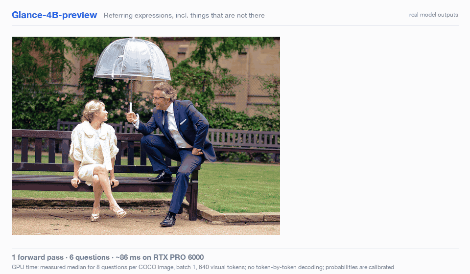
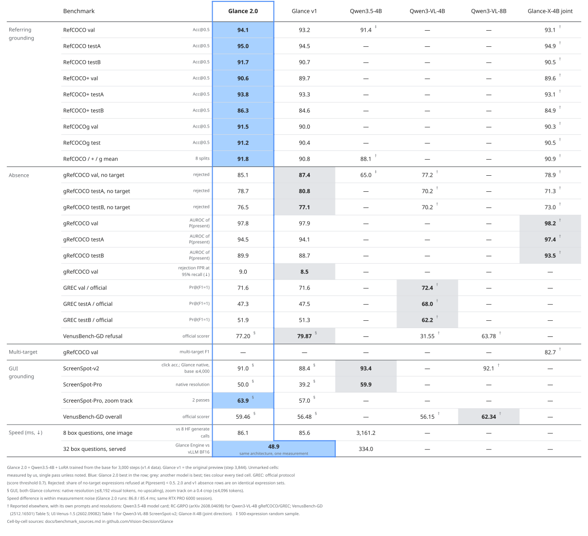

# Glance

**一次前向，对图像或文本给出校准过的类型化决策。**

[English](README.md) · [用法](#用法) · [基准](README.md#benchmarks) · [Hugging Face 权重](https://huggingface.co/Vision-Decision/Glance-4B-preview) · [更新日志](CHANGELOG.md)

Glance 回答类型化问题：找到某个物体、从选项中挑一个、判断是或否、按等级打分，每个答案都带校准过的概率。图像或文本只读一次，所有问题都由这一次 prefill 回答，不逐 token 生成。目标不在图里时，它会回答"不存在"并给出概率。在 RTX PRO 6000 上，对一张 COCO 图片问 8 个问题约 **86 ms**，和问 1 个一样；生成式的基座模型需要 3.2 s。



## 快速开始

```bash
pip install "glance @ git+https://github.com/Vision-Decision/Glance"
pip install flash-linear-attention   # 可选，仅 CUDA：Gated-DeltaNet 快速内核
```

```python
from glance import Glance

m = Glance.from_pretrained("Vision-Decision/Glance-4B-preview")   # 依次尝试 cuda、mps、cpu
r = m.box("assets/examples/park_bench.jpg", "the clear umbrella")
print(r.present_prob, r.box, r.confidence)                 # 0.995 (191, 5, 372, 166) 0.915
```

当前权重是 **Glance 2.0**：在 Qwen3.5-4B 基座上从头训 3,000 步（v1.4 数据）。原来的预览版 v1 保留在同一仓库的 tag `v1` 下，用 `Glance.from_pretrained("Vision-Decision/Glance-4B-preview", revision="v1")` 加载。

首次调用会下载 Qwen3.5-4B 基座权重（约 9 GB）以及 Glance 的 adapter 和 heads（约 537 MB）。

## 四种原语

| 原语 | 输入 | 输出 |
|---|---|---|
| `box` | 指代表达 | P(存在)、像素框、P(IoU ≥ 0.5)，以及框置信度 = P(存在) · P(IoU ≥ 0.5) |
| `choice` | 问题和 2–26 个选项 | 每个选项的概率 |
| `yesno` | 是非问题 | P(是) |
| `score` | 问题和有序等级 | 每个等级的概率和期望等级 |

## 用法

```python
from glance import Glance, Choice, YesNo, Score

m = Glance.from_pretrained("Vision-Decision/Glance-4B-preview")
m.box("assets/examples/park_bench.jpg", "a red bicycle")          # 图中没有
# BoxResult('a red bicycle', present_prob=0.000, box=[465, 213, 583, 265], confidence=0.000)
m.yesno("assets/examples/editor.png", "Is a save dialog open?")
# YesNoResult(p_yes=0.998)

# 一次共享前缀前向回答多个问题；纯字符串表示 box 问题
rs = m.ask("assets/examples/vegetables.jpg", [
    "the broccoli", "a banana",
    YesNo("Is this food cooked?"),
    Choice("What is the main food group?", ["vegetables", "meat", "dairy", "grains"]),
    Score("How healthy is this food?", ["unhealthy", "neutral", "healthy", "very healthy"]),
])
```

文本也一样，把字符串作为状态传入即可，例如 `m.choice(ticket, "Which team should handle this ticket?", [...])`。截图建议设 `max_vis_tokens=2048`。更多示例、真实输出和完整说明见 [英文 README](README.md#usage)。

## 基准

<picture>
  <source media="(prefers-color-scheme: dark)" srcset="assets/benchmark-table-dark.svg">
  
</picture>

Glance 2.0 在 RefCOCO 全部 8 个 split 上都高于 v1（平均 91.8 对 90.8）。拒答目标不存在的能力和 v1 持平：召回 95% 时的拒答 FPR 为 9.0 对 8.5（差 +0.49，95% CI [-0.15, +1.25]），官方 GREC val 都是 71.6；但在默认 0.5 阈值下 2.0 拒得少一些（gRefCOCO val 无目标题 85.1% 对 87.4%），依赖拒答时请按自己的召回目标设 `present_prob` 阈值。GUI 定位上两者都按原图分辨率评测：ScreenSpot-v2 91.0 对 88.4，ScreenSpot-Pro 50.0 对 39.2（zoom 两段式 63.9 对 57.0），VenusBench-GD 总分 59.5 对 56.5。和其他模型比，Glance-X-4B 在存在判断 AUROC 上领先，Qwen3-VL-4B 在官方 GREC 指标上领先，生成式基座和 Qwen3-VL 在 ScreenSpot 上领先。蓝色格表示 Glance 2.0 最好，灰色格表示其他模型最好。数据来源、评测协议和脚注见 [英文 README](README.md#benchmarks)。

## 许可

- 本仓库代码：Apache-2.0。
- 权重（`Vision-Decision/Glance-4B-preview`，主分支为 Glance 2.0，tag `v1` 为原预览版）：**CC BY-NC 4.0，仅限非商业用途**。训练数据包含仅限非商用的 gRefCOCO，以及部分许可无法确认的文本数据源。
- 基座模型 Qwen/Qwen3.5-4B：Apache-2.0。
